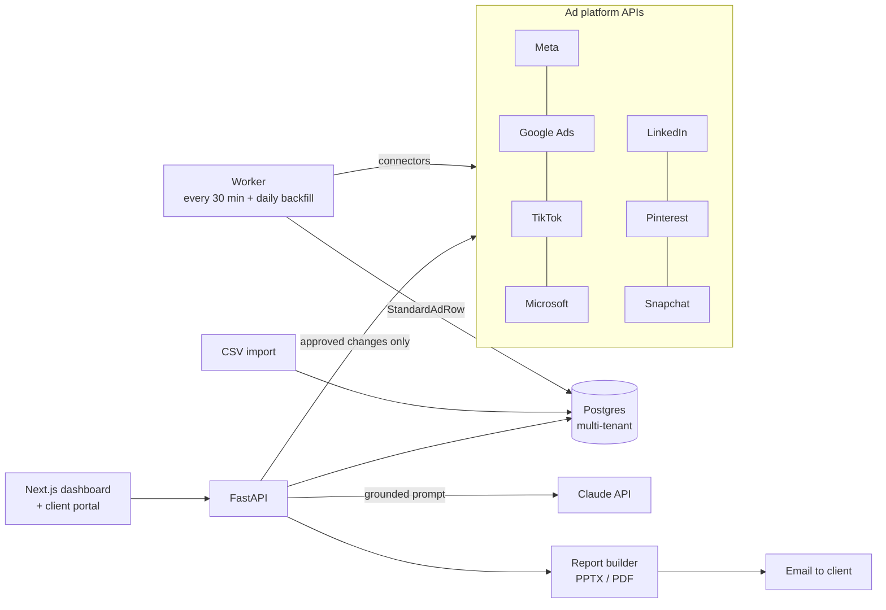

# Adsorra: client ad reports that build themselves

Adsorra is a SaaS for marketing agencies. It pulls ad performance from every platform a client
advertises on, puts it into one standard shape, ranks the best and worst creatives, flags what to fix,
and turns it all into branded client reports that an owner approves before they go out.

Live product: [adsorra.com](https://adsorra.com). This repository is a **portfolio showcase**: the
README, the architecture and a handful of real modules from the codebase. The full source is private
(it is a paid product) and I am happy to walk through it on a call.

<!-- Add 3 screenshots here: dashboard, creative ranking, report preview. Use the demo data, never a real client.

-->

## The problem

An agency running ads for 10 to 50 clients spends hours every week logging into Meta, Google, TikTok,
LinkedIn and the rest, exporting numbers into spreadsheets and pasting them into slides. Every platform
names things differently, and the reports are late, inconsistent and hard to act on.

## What Adsorra does

| Area | What it does |
|---|---|
| **Connect** | 7 ad platform integrations (Meta, Google Ads, TikTok, Microsoft Ads, LinkedIn, Pinterest, Snapchat) plus CSV import for anything else (e.g. AdRoll). Tokens are encrypted at rest and never logged or returned. |
| **Normalize** | Every connector returns the same `StandardAdRow`, so storage, ranking, dashboards and reports never see platform-specific fields. |
| **Analyze** | Dashboards for spend, funnel, campaigns, creatives and data health. Creatives are ranked by the client's goal (CPA, ROAS or CTR) with a minimum-spend filter so a lucky $5 ad can't win. |
| **AI assistant** | A chat panel per client, powered by Claude. The prompt is grounded only in that client's numbers, with rules against guessing and against prompt injection hidden in campaign names. Agencies bring their own API key. |
| **Optimize (human in the loop)** | Suggests pausing weak ads or raising budgets behind winners. Nothing changes on a platform until an agency owner clicks Approve, and each change is applied at most once. |
| **Report** | 50 report templates (weekly to yearly, executive or detailed) exported to PowerPoint and PDF. Draft, edit, owner approves, then send. |
| **Share** | Client portal logins that see only their own approved reports, team seats and invites. |
| **Monetize** | Subscription billing through a merchant of record, pay-first signup flow. Plans from $149 to $499 per month. |

## Architecture

More detail, including the tenancy model and why it does not poll every few seconds, is in
[docs/architecture.md](docs/architecture.md).

## Tech stack

- **Backend:** Python 3.11, FastAPI, psycopg 3 with plain SQL (no ORM), httpx, Pydantic
- **Database:** PostgreSQL, 13 hand-written migrations, composite foreign keys for tenant isolation
- **Frontend:** Next.js 15, React 19, TypeScript
- **AI:** Anthropic Messages API (Claude), bring-your-own-key, encrypted storage
- **Security:** Fernet encryption for tokens and keys, bcrypt passwords, JWT auth, rate limiting, secret redaction on every error path
- **Reports:** python-pptx, LibreOffice for PDF
- **Ops:** Docker Compose, Caddy (automatic HTTPS), background worker
- **Tests:** 400+ pytest tests, including a security sweep that fails if any route lacks a tenant isolation test

Size: about 7,000 lines of Python in the API, 4,200 lines of tests, 2,900 lines of TypeScript in the web app.

## Code samples in this repo

| File | Why it is interesting |
|---|---|
| [`samples/connectors/base.py`](samples/connectors/base.py) | The contract every platform connector implements. Adding a platform means adding one file. |
| [`samples/connectors/tiktok.py`](samples/connectors/tiktok.py) | A full connector: pagination, 30-day report windows, error mapping, pause and budget changes. |
| [`samples/connectors/common.py`](samples/connectors/common.py) | Shared HTTP and OAuth refresh helpers that scrub secrets from every error. |
| [`samples/ranking.py`](samples/ranking.py) + [`test_ranking.py`](samples/test_ranking.py) | Goal-aware creative ranking. Runs on its own: `cd samples && pytest test_ranking.py`. |
| [`samples/ai_assistant.py`](samples/ai_assistant.py) | How the Claude prompt is built from one client's data, and how API failures become clear messages. |
| [`samples/approval_flow.py`](samples/approval_flow.py) | Human-in-the-loop changes: claim the row, call the platform, record the result, never get stuck. |
| [`samples/schema/tenancy_excerpt.sql`](samples/schema/tenancy_excerpt.sql) | Multi-tenant schema where the database itself refuses cross-agency links. |

The samples are excerpts, so most of them import modules that are not in this repo.

## Design decisions I would defend in an interview

1. **One standard row shape.** Platform quirks stay inside `connectors/`. The rest of the app is platform-agnostic.
2. **Tenant isolation twice.** In the API (other tenants get a 404, never a 403) and in the schema (composite `(id, agency_id)` foreign keys).
3. **No 5-second polling.** Platforms revise conversions for days and rate-limit hard, so the worker pulls every 30 minutes and backfills daily. The UI polls our own database instead.
4. **AI suggests, people decide.** The assistant and the optimizer never change a campaign on their own.
5. **Secrets never leave.** Every error message passes through one `redact()` function before it is logged, stored or shown.

## Honest notes

- **Built with AI.** I designed the product, made the product and architecture decisions, and wrote the
  specs and rules; the code was written together with Claude (Anthropic's AI) in Claude Code. I review,
  test and ship it, and I can explain how each part works.
- **Integration status.** All connectors are covered by tests against mocked API responses. Meta is the
  most complete; the others were written from each platform's API docs and stay labeled beta in the app
  until they have run against live accounts.

## About me

Mohsin Ali, founder of Adsorra. GitHub: [@mohsinmalick222-netizen](https://github.com/mohsinmalick222-netizen).

## License

Copyright (c) 2026 Mohsin Ali. All rights reserved. The code here is shared so people can read it as a
portfolio sample; it is not licensed for reuse.
