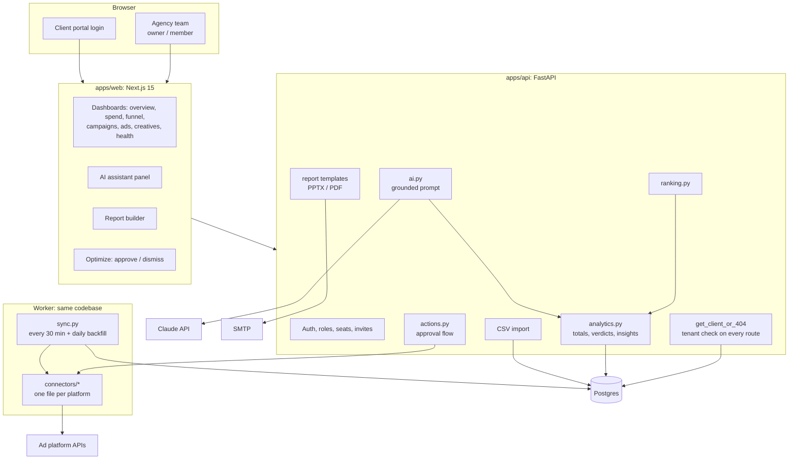

# Architecture

## Tenancy
Every tenant row carries `agency_id`. Child tables reference their parents through composite
`(id, agency_id)` foreign keys, so the database refuses a row linked across agencies. Routes load clients
only through one helper that treats "another agency's client" and "not your client" exactly like
"does not exist" (404). Client-portal logins are tied to exactly one client. A test sweeps every route and
fails if a new route has no isolation test.

## One standard shape
Connectors return `StandardAdRow` (date, ad, campaign, creative, spend, impressions, clicks,
conversions, revenue). Storage, ranking, dashboards, the AI prompt and reports only see that shape.

## Freshness: why not every 5 seconds
Ad platforms publish with delays of minutes to hours, keep revising conversions for days, and
rate-limit their APIs. Polling every few seconds adds no data and risks throttling. The worker pulls a
short recent window every 30 minutes and re-pulls a longer window once a day. Each pull replaces the
metric rows for its date window in one transaction, so late corrections never leave stale numbers.
A "refresh now" button exists with a cooldown, and the web app polls our own database.

## Secrets
Platform tokens and customer AI keys are Fernet-encrypted in the database, never returned by the API and
never logged. Every error path runs through `redact()`, which strips token parameters, bearer headers
and the known secret values.

## Changes to live campaigns
Suggestions come from the same rules as the dashboard's insights. An owner must approve each one. The
row is claimed (`pending` to `applying`) before the platform is called, so a double click cannot apply a
change twice, and any failure is recorded as `failed` instead of leaving the row stuck.
